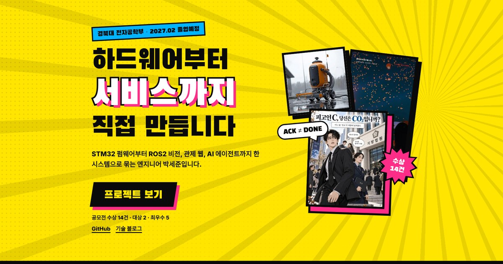

# 박세준 포트폴리오 — 만화 컷 에디션



하드웨어부터 서비스까지 직접 만든 프로젝트 · 수상 · 작품을 만화책 한 권처럼 엮은 정적 포트폴리오입니다.
프레임워크나 빌드 도구 없이 HTML · CSS · 바닐라 JS로만 동작합니다.

## 구성

| 화 | 내용 |
|---|---|
| 표지 | 소개 · 대표 컷 · 효과음 띠(프로젝트 숫자 8개) |
| EP.01 대표 프로젝트 | 카드 6장 → 누르면 상세 이야기(`#p-threebot`처럼 주소로 바로 열림) · 그 외 프로젝트 9개 |
| EP.02 문제를 푸는 순서 | 증상 → 원인 → 구조 → 기준 → 검증 → 반복 → 기록 → 번역 |
| EP.03 상 받은 기록 | 수상 14건 (대상 2 · 최우수 5 · 우수 4 · 은상 1 · 장려 2) |
| EP.04 만든 것들 | 작품 18점을 만화 컷으로 배치 · 누르면 크게 보기(←/→ 키, 스와이프) |
| EP.05 쓰는 도구 | 분야별 도구 |
| 다음 화에 계속 | 작가 소개 · 연락 |

## 폴더

```
content/site.mjs     문구 전부 (소개, 프로젝트, 일하는 순서, 도구, 작가 소개)
content/works.mjs    작품 목록
content/awards.mjs   수상 목록
build.mjs            content → index.html 생성 (의존성 없음)
styles.css           디자인
main.js              등장 효과 · 프로젝트 상세 · 작품 크게 보기
assets/              이미지(WebP) · 파비콘 · 링크 미리보기 이미지(og.jpg)
index.html           생성 결과 — 직접 고치지 않습니다
```

## 고치는 법

1. `content/*.mjs`에서 문구나 목록을 고칩니다.
2. `node build.mjs`로 `index.html`을 다시 만듭니다. (Node 18 이상)
3. 커밋하고 푸시하면 배포된 사이트에 반영됩니다.

새 작품을 넣을 때는 이미지를 `assets/img/works/`에, 첫 장과 같은 파일명의 썸네일(가로 720px 안팎)을 `assets/img/thumb/`에 넣고 `content/works.mjs`에 항목을 하나 추가합니다. `award`를 비워 두면 배지 없이 출품작으로 표시됩니다.

로컬에서 보기: `python3 -m http.server 8000` → http://localhost:8000

## 배포

정적 파일을 그대로 올리면 됩니다. 빌드 명령은 비워 둡니다.

- **Vercel**: Add New → Project → `mnunu123/portfolio_mysite` Import → Framework Preset `Other` → Build Command 비움 → Deploy
- **Netlify**: Add new site → Import an existing project → 저장소 선택 → Build command 비움, Publish directory `.` → Deploy

배포 주소가 정해지면 `content/site.mjs`의 `meta.url`에 넣고 다시 빌드하세요. 카카오톡 · 슬랙에서 링크 미리보기 이미지가 제대로 잡힙니다.
